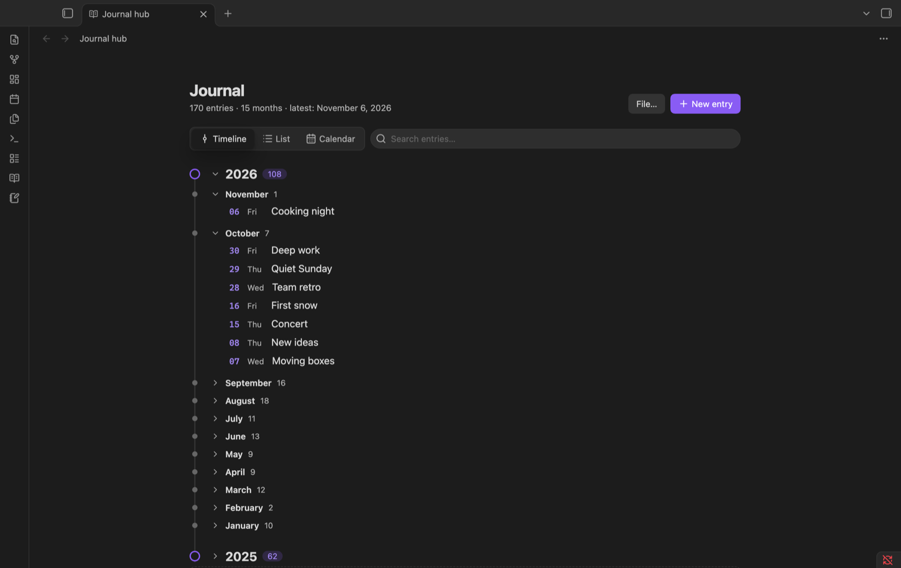
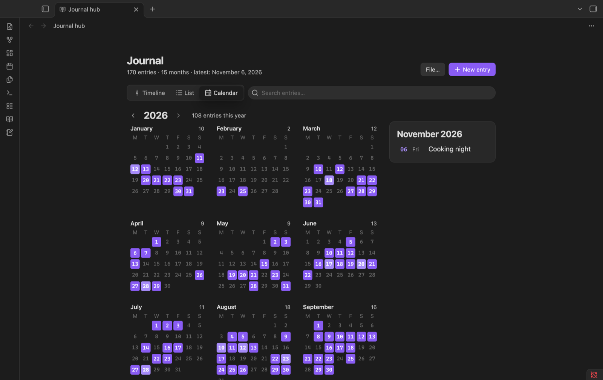
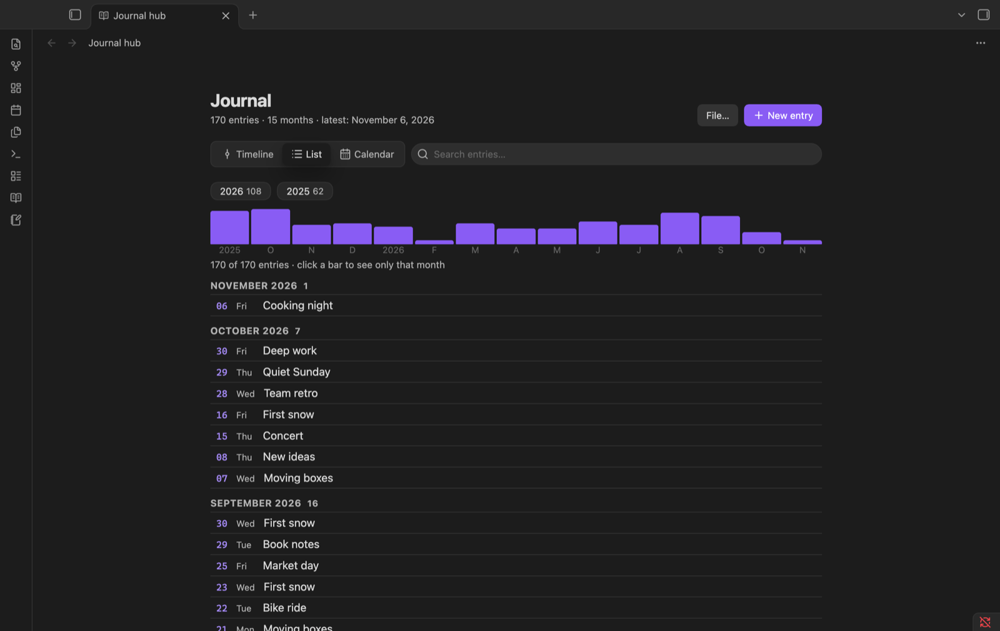
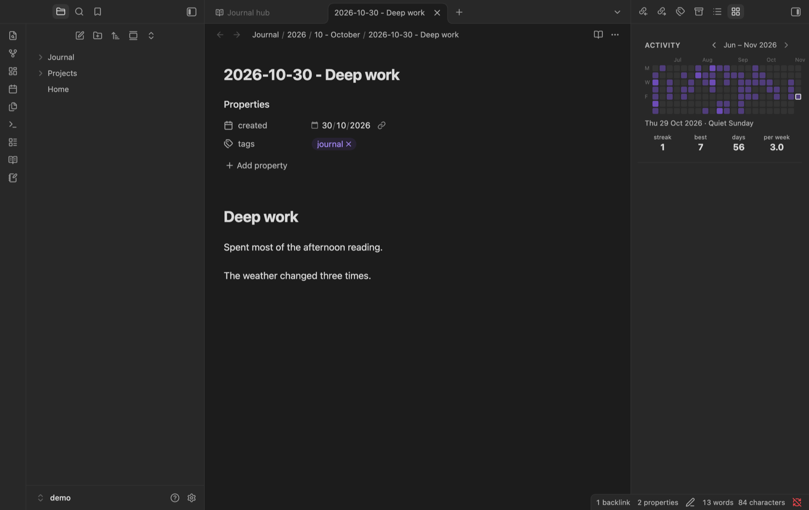
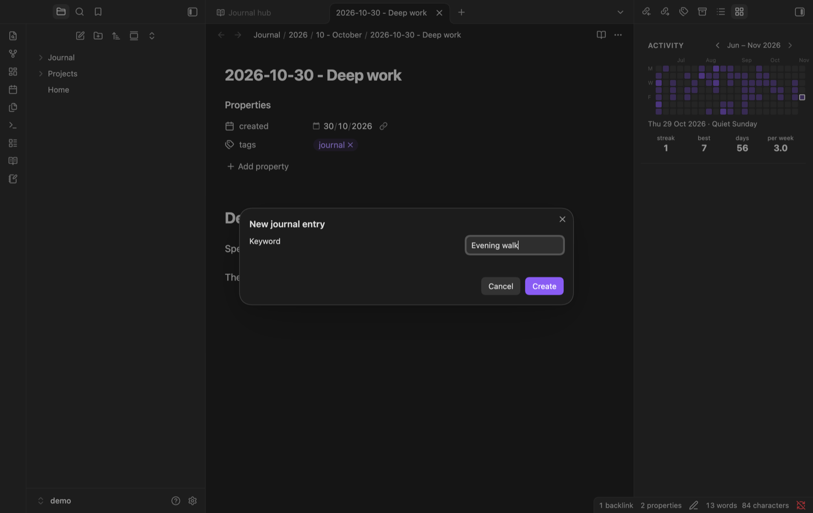
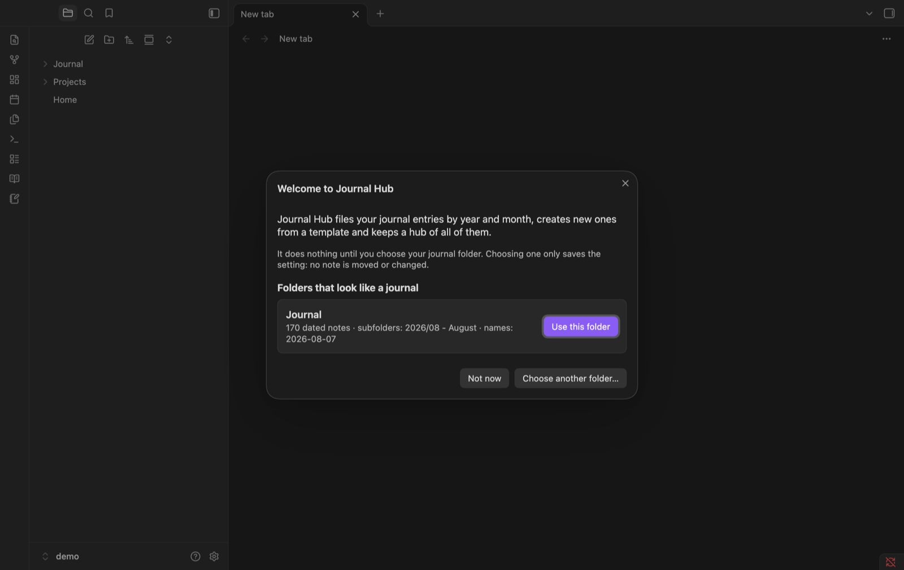

# Journal Hub

Keep a journal in Obsidian without filing it by hand. Journal Hub creates each entry from a template,
files it into year and month folders, and gives you one place to browse every entry: a hub view, a
GitHub-style activity grid and a plain Markdown index you can read anywhere.



<sub>Screenshots use a test vault with invented entries.</sub>

## Features

- **New entries from a template.** One command (or the ribbon button) asks for a keyword and creates
  `2026-08-07 - Keyword.md` directly in its folder, filled from a template, with the cursor where you
  start writing. A built-in template is ready to use; you can add your own.
- **Automatic filing.** When a note inside your journal gets a dated name, it is moved to its
  year/month folder and missing folders are created. A command files existing entries, showing you
  every move before anything happens. Folders it leaves empty go to the trash.
- **Turn any note into an entry.** When an empty note appears in your journal folder (new note button,
  file explorer, mobile), Journal Hub asks whether to make it an entry. Say no and you can do it later
  from the command palette or the file menu. Existing text and properties are kept.
- **Hub view** with three modes: a **timeline** (years and months that fold), a **list** with a
  bar per month to filter by, and a **calendar**. Search ignores accents and case. Click to open an
  entry, hover to preview it.
- **Activity** in the sidebar: a compact GitHub-style grid of the days you wrote, with your current
  streak, best streak, days written and entries per week. Give it more room and it grows.
- **Hub note**: a Markdown note with links to every entry by year and month, to read your journal
  without the plugin (mobile, GitHub). It is rewritten only when entries change.
- **Works with your structure.** Any journal folder (nested or the vault root), any subfolder layout,
  month names in English or Spanish, any date format in the entry name.
- **Safe first run.** Until you choose a journal folder it does nothing. On first launch it suggests
  folders that already look like a journal and detects how they are organised. Choosing one only
  saves the setting: no note is moved or changed.

## Screenshots

| Calendar | List |
|---|---|
|  |  |

| Activity in the sidebar | New entry |
|---|---|
|  |  |

| First run |
|---|
|  |

## Getting started

1. Install and enable Journal Hub.
2. On first launch, pick one of the suggested folders (or choose any folder in the settings).
3. Create an entry with **Journal Hub: Create new entry** or the notebook button in the ribbon.
4. Open the hub (book button) and the activity grid (grid button) from the ribbon, or with **Journal Hub: Open journal hub** and **Journal Hub: Open journal activity**.

## How it works

### Entry names

An entry is a note whose name **starts with a date**, optionally followed by a separator and a
keyword: `2026-08-07`, `2026-08-07 - Long walk`, `07-08-2026 - Long walk`… The date format is a
setting (`YYYY-MM-DD` by default). Notes in the journal folder without a date in the name are listed
apart in the hub and never moved. If such a note has a date property (`created` by default, ISO
format), it is shown in the hub by that date, but never moved.

### Folder layout

Entries are filed under the journal folder following a pattern. Common layouts are offered in the
settings; you can also write your own.

| Pattern | Example |
|---|---|
| `YYYY/MM` (default) | `Journal/2026/08/2026-08-07.md` |
| `YYYY/MM - MMMM` | `Journal/2026/08 - August/…` |
| `YYYY/YYYY-MM` | `Journal/2026/2026-08/…` |
| `YYYY` | `Journal/2026/…` |
| *(empty)* | everything directly in the journal folder |

Tokens: `YYYY`, `YY`, `MMMM` (month name), `MMM` (short month name), `MM`, `M`, `DD`, `D`. Text in
`[brackets]` is literal. Month names can be English or Spanish, lowercase, capitalized or uppercase.

The defaults (`YYYY/MM` folders, `YYYY-MM-DD` names) are the most common choice and sort correctly in
any file explorer.

### Templates

The built-in template:

```markdown
---
title: {{title}}
created: {{date}}
kind: Daily Journal
---
# {{keyword}}

{{cursor}}


---
# Tags:

#dailyNote #journal #journal/dailyNote
```

To make your own, choose a **templates folder** in the settings (notes there never count as entries)
and run **Copy built-in template to templates folder** to start from the built-in one. Placeholders
(no code is run):

| Placeholder | Becomes |
|---|---|
| `{{date}}` | entry date, ISO (`2026-08-07`), the format properties understand |
| `{{date:FORMAT}}` | entry date with tokens, e.g. `{{date:D MMMM YYYY}}` |
| `{{time}}` | creation time, `HH:mm` |
| `{{keyword}}` | the keyword you typed |
| `{{title}}` | the full note name (`2026-08-07 - Keyword`) |
| `{{cursor}}` | where the cursor goes (and where existing text goes when converting a note) |

### Hub note

By default `Journal Hub.md` inside the journal folder (the path is a setting). It carries the
property `journal-hub: generated` and a notice that the plugin writes it. Journal Hub never overwrites
a note at that path without that property. It has no "last updated" line, so it only changes when
your entries do, which keeps Git-synced vaults quiet.

## Commands

| Command | |
|---|---|
| Create new entry | Asks for a keyword (and template) and creates today's entry |
| Turn current note into an entry | Also in the file menu |
| File misplaced entries… | Shows every move and asks before moving |
| Open journal hub | |
| Open journal activity | Opens in the right sidebar (also a ribbon button) |
| Update hub note now | |
| Copy built-in template to templates folder | |
| Set up Journal Hub | Opens the first-run screen again |

No command has a default hotkey.

## Privacy

- No network access, no telemetry.
- Journal Hub works from note **names, dates and properties**. The only note text it reads is: a new
  note's, to check that it is empty before offering to convert it; the note you choose to convert,
  to keep its text; and its own hub note.
- Moves use Obsidian's file manager, so links follow your *Automatically update internal links*
  setting (if it is off, Obsidian asks for each note that has links).

## Compatibility

Obsidian 1.15.0 or later, desktop and mobile. The interface is in English and Spanish (it follows
Obsidian's language).

## Installation

- **Community plugins:** search for *Journal Hub* (once it is listed).
- **Manual:** download `main.js`, `manifest.json` and `styles.css` from the latest
  [release](../../releases) into `<vault>/.obsidian/plugins/journal-hub/`, then enable it in
  *Settings → Community plugins*.

## Development

`npm install`, then `npm run dev`. Tests: `npm test`. Notes for contributors (in Spanish) are in
[docs/desarrollo.md](docs/desarrollo.md).

## En español

Journal Hub crea las entradas de tu journal con una plantilla, las acomoda en carpetas por año y mes
y te da un hub para verlas todas (línea de tiempo, lista y calendario), un mosaico de actividad en la
barra lateral y una nota índice que se regenera sola. La interfaz está en español si Obsidian está en
español. No se conecta a internet ni lee el texto de tus entradas.

## License

[MIT](LICENSE)
